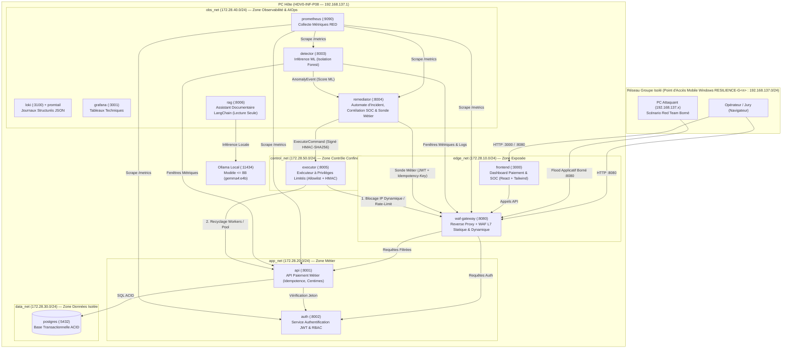
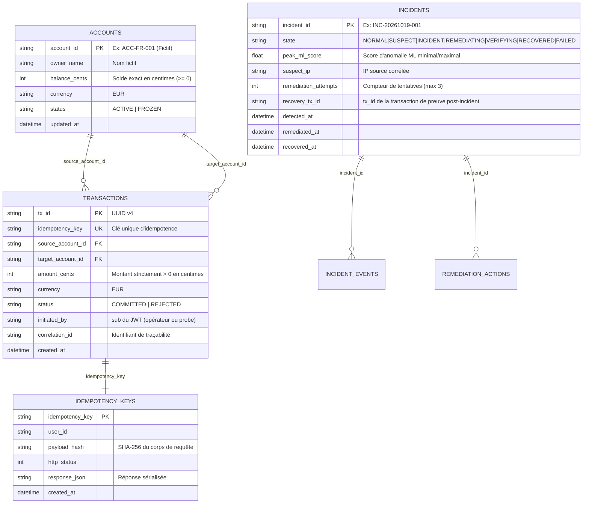
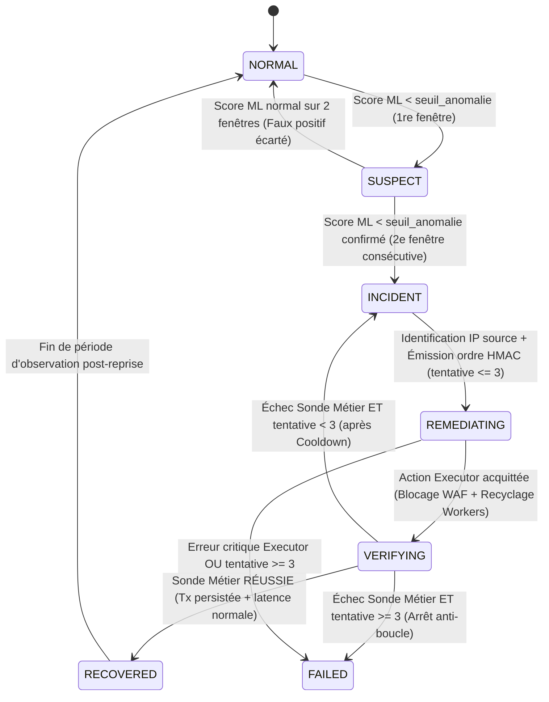

# Architecture Système, Réseau et Automate de Résilience (`docs/architecture.md`)

Document de conception de référence — **PROJECT RESILIENCE-ALPHA** (Étape 1).

---

## 1. Vue d'Ensemble de l'Architecture Cible

La plateforme **RESILIENCE-ALPHA** met en œuvre un système d'information de paiement fictif conteneurisé, supervisé par une chaîne AIOps de détection par Machine Learning (`IsolationForest`) et de remédiation autonome (**Zero-Touch Recovery**).

### 1.1 Schéma d'Architecture et Topologie Réseau

---

## 2. Segmentation Réseau, Ports et Flux Autorisés

Conformément au principe du moindre privilège (Section 3.4 & Section 4 du sujet), l'infrastructure Docker Compose est découpée en **5 réseaux bridges internes séparés** :

| Réseau Docker | Sous-réseau | Services Rattachés | Publication Hôte | Justification Sécurité |
| :--- | :--- | :--- | :--- | :--- |
| `edge_net` | `172.28.10.0/24` | `waf-gateway`, `frontend` | `:8080` (WAF), `:3000` (UI) | Seuls points d'entrée accessibles depuis le réseau du groupe (`192.168.137.0/24`). |
| `app_net` | `172.28.20.0/24` | `waf-gateway`, `api`, `auth`, `remediator` | Aucune (`internal`) | L'API métier et le service d'authentification ne sont pas joignables directement sans passer par `waf-gateway`. |
| `data_net` | `172.28.30.0/24` | `api`, `auth`, `postgres` | Aucune (`internal: true`) | PostgreSQL est strictement isolé : ni le frontend, ni le WAF, ni le RAG, ni le réseau externe ne peuvent l'atteindre. |
| `obs_net` | `172.28.40.0/24` | `prometheus`, `grafana`, `loki`, `promtail`, `detector`, `remediator`, `rag`, `api`, `waf-gateway` | `:3001` (Grafana local `127.0.0.1`) | Collecte télémétrique hors bande et consultation opérateur. |
| `control_net` | `172.28.50.0/24` | `remediator`, `executor`, `waf-gateway`, `api` | Aucune (`internal: true`) | Canal d'administration confiné : seul `remediator` peut émettre un ordre signé HMAC vers `executor`. |

### Matrice des Flux Autorisés

| Source \ Destination | `waf-gateway` | `api` | `auth` | `postgres` | `detector` | `remediator` | `executor` | `rag` |
| :--- | :---: | :---: | :---: | :---: | :---: | :---: | :---: | :---: |
| **Externe (Opérateur / PC Attaquant)** | **OUI (:8080)** | NON | NON | NON | NON | NON | NON | NON |
| **`frontend` (:3000)** | **OUI** | NON (via WAF) | NON (via WAF) | NON | NON | Lecture SOC (via WAF) | **INTERDIT** | Lecture RAG (via WAF) |
| **`waf-gateway` (:8080)** | — | **OUI** | **OUI** | NON | NON | Lecture `/soc/*` | **INTERDIT** | Lecture `/rag/*` |
| **`api` (:8001)** | NON | — | **OUI** | **OUI (:5432)** | NON | NON | **INTERDIT** | NON |
| **`detector` (:8003)** | Lecture `/metrics` | Lecture `/metrics` | NON | NON | — | **POST `/events`** | **INTERDIT** | NON |
| **`remediator` (:8004)** | **Sonde Métier** | Lecture `/health` | **Sonde Auth** | NON | Lecture `/status` | — | **POST `/execute` (HMAC)** | NON |
| **`executor` (:8005)** | **Admin WAF** | **Admin Workers** | NON | NON | NON | NON | — | NON |
| **`rag` (:8006)** | NON | NON | NON | NON | NON | NON | **INTERDIT** | — |

---

## 3. Services et Responsabilités

1. **`services/frontend` (React + Tailwind CSS)** :
   - Portail de paiement fictif (création de transaction avec génération automatique ou manuelle d'`Idempotency-Key`, historique en temps réel, soldes des comptes).
   - Console de supervision SOC & AIOps (état de l'automate d'incident, jauge du score ML `IsolationForest`, chronologie corrélée des événements, temps mesurés MTTD/MTTR, statut de la dernière sonde métier, interface de questionnement de l'assistant RAG).
2. **`services/waf_gateway` (Passerelle Reverse Proxy & WAF Dynamique)** :
   - Inspection L7 synchrone des requêtes entrantes : blocage immédiat par signatures des attaques classiques (SQLi, XSS, Path Traversal, Command Injection).
   - Application de la liste de blocage dynamique (`dynamic_blocklist` avec expiration TTL) et des profils de limitation de débit (`normal` vs `strict_mitigation`).
   - Journalisation structurée de chaque requête avec `correlation_id`, `source_ip`, `path`, `status_code`, `latency_ms` et `waf_action`.
3. **`services/auth` (Authentification & RBAC)** :
   - Émission et vérification de jetons JWT signés (`HS256`) avec expiration courte.
   - Gestion des profils fictifs : `merchant_operator` (création/lecture transactions), `resilience_probe` (sonde métier automatisée), `auditor_readonly` (consultation).
4. **`services/api` (API Métier de Paiement)** :
   - Traitement transactionnel atomique : débit du compte émetteur, crédit du compte bénéficiaire, enregistrement dans `transactions` et `ledger_entries`.
   - Garantie d'exactitude monétaire : tous les calculs sont réalisés en **centimes entiers (`amount_cents: int`)**.
   - Garantie d'idempotence : table `idempotency_keys` associant `(idempotency_key, user_id)` à l'empreinte SHA-256 de la charge utile et à la réponse enregistrée.
   - Endpoint de rapprochement intensif `/api/v1/transactions/verify-batch` (profilé pour illustrer une charge CPU/IO réaliste lors d'appels massifs concurrents).
5. **`services/detector` (Moteur ML d'Inférence AIOps)** :
   - Collecte périodique (toutes les 2 s) des fenêtres d'observation sur le WAF et l'API métier.
   - Calcul du vecteur à 7 caractéristiques et inférence via le modèle entraîné `IsolationForest` (`ml/artifacts/isolation_forest.joblib`).
   - Émission d'un `AnomalyEvent` vers `services/remediator` dès que le score franchit le seuil calibré.
6. **`services/remediator` (Orchestrateur d'Incident, Corrélation SOC & Sonde Métier)** :
   - Maintient l'automate d'incident et la corrélation SOC.
   - Identifie l'adresse IP responsable de la saturation à partir des journaux structurés du WAF.
   - Émet les ordres signés HMAC vers `services/executor`, attend la désaturation, puis exécute la **sonde métier complète** (authentification + transaction fictive idempotente + vérification en base) avant de déclarer `RECOVERED`.
7. **`services/executor` (Exécuteur à Privilèges Limités)** :
   - Vérifie la signature `HMAC-SHA256`, la fraîcheur de l'horodatage (`<= 30 s`) et l'appartenance de l'action à la liste fermée (`block_ip_waf`, `set_rate_limit_profile`, `recycle_api_workers`, `reset_connection_pool`).
   - Refuse toute adresse IP protégée (loopback de sonde interne, passerelle par défaut) et toute entrée non conforme au schéma strict.
   - Écrit chaque exécution dans un journal d'audit chaîné par hachage (`audit_chain_hash`).
8. **`services/rag` (Assistant Documentaire Local Ollama + LangChain)** :
   - Indexe les documents Markdown du projet (`docs/`, `AGENTS.md`, `infra/ansible/`).
   - Répond aux questions des opérateurs avec citations exactes des sections sources. Ne possède aucun droit réseau ni fonctionnel sur l'infrastructure.

---

## 4. Modèle de Données Métier et Supervision

---

## 5. Automate d'Incident et Garde-Fous de Reprise

### 5.1 Diagramme d'États de l'Automate (`services/remediator`)

### 5.2 Règles de Protection de l'Automate
1. **Confirmation multi-fenêtres (Anti-bruit)** : Une seule fenêtre anormale place le système en état `SUSPECT`. L'état `INCIDENT` (qui déclenche la remédiation) exige **2 fenêtres consécutives** au-delà du seuil calibré du modèle ML, ou 1 fenêtre accompagnée d'un échec direct de la sonde métier.
2. **Déduplication des alertes** : Tant qu'un incident `INC-*` est dans l'état `INCIDENT`, `REMEDIATING` ou `VERIFYING`, les nouveaux événements ML sont rattachés à l'incident actif sans ouvrir d'incident parallèle.
3. **Limitation des tentatives (`MAX_ATTEMPTS = 3`) et Anti-boucle** : Si 3 cycles de remédiation échouent à restaurer une transaction métier valide, l'automate bascule dans l'état visible `FAILED`, verrouille toute nouvelle action automatique et affiche une alerte critique pour l'opérateur humain.
4. **Cooldown (`COOLDOWN_SECONDS = 15`)** : Délai minimal obligatoire entre deux actions de remédiation sur un même composant pour laisser la désaturation opérer.
5. **Expiration des blocages (`BLOCK_TTL_SECONDS = 300`)** : Tout blocage d'IP dans le WAF dynamique possède une durée de vie bornée (5 minutes par défaut) afin d'éviter un déni de service permanent en cas d'IP partagée (NAT).
6. **Critère strict de passage à `RECOVERED`** :
   - L'API répond sur `/health` en moins de 500 ms ;
   - Le service `remediator` obtient un jeton JWT frais auprès de `services/auth` ;
   - Il exécute `POST /api/v1/transactions` avec une nouvelle clé `Idempotency-Key: probe-recovery-<incident_id>` et un montant de `100` centimes (`1,00 €`) entre deux comptes techniques dédiés ;
   - Il relit `GET /api/v1/transactions/<tx_id>` et vérifie que `status == "COMMITTED"` et que le doublon idempotent est bien rejeté/absorbé.

---

## 6. Scénario d'Attaque Principal et Complémentarité WAF / ML

- **Nature du scénario** : Épuisement applicatif contrôlé de couche 7 (*Application-Layer Resource Exhaustion* sur `/api/v1/transactions/verify-batch`).
- **Pourquoi le trafic passe le WAF initial** :
  - Le WAF statique inspecte la syntaxe HTTP et bloque immédiatement les charges contenant des motifs d'injection (`UNION SELECT`, `<script>`, `../`).
  - Or, le scénario principal envoie des requêtes JSON **syntaxiquement valides et conformes au schéma attendu**, demandant le contrôle cryptographique d'un lot d'opérations. Individuellement, une requête est légitime ; envoyée en rafale soutenue depuis le PC Attaquant, elle sature les workers de l'API métier, fait bondir la latence P95 (`> 800 ms`) et dégrade le traitement des paiements légitimes.
- **Comment la défense dynamique réagit** :
  - Le modèle `IsolationForest` détecte la dérive conjointe des 7 métriques (latence P95, taux de saturation workers, ratio de route coûteuse, baisse d'entropie IP).
  - `remediator` corrèle cette anomalie avec les logs du WAF et identifie l'IP source qui génère plus de 70 % des appels coûteux sur la fenêtre.
  - `executor` injecte dynamiquement cette IP dans la `dynamic_blocklist` du WAF (HTTP 429/403 immédiat en bordure) et recycle les workers saturés de l'API métier.
  - **Preuve sous attaque continue** : Alors même que le script offensif continue d'envoyer des requêtes pendant encore 15 à 20 secondes, le WAF les bloque en `< 1 ms` à la périphérie, l'API métier retrouve une latence `< 30 ms`, et la nouvelle transaction métier réussit.

---

## 7. Budget de Ressources Estimatif (PC Hôte `HDV0-INF-P08`)

> **Important** : Les valeurs ci-dessous constituent le **budget de dimensionnement estimatif** (limites configurées dans `docker-compose.yml`), adapté aux 31,4 Go de RAM totale (~4,5 Go disponibles au moment de l'audit) et 41,4 Go d'espace disque libre du PC Hôte.

| Conteneur / Composant | Limite CPU (`cpus`) | Limite RAM (`mem_limit`) | Image de Base | Estimation Disque |
| :--- | :---: | :---: | :--- | :---: |
| `postgres` | `0.50` | `256M` | `postgres:16-alpine` | ~240 Mo |
| `auth` | `0.25` | `128M` | `python:3.12-slim` (partagée) | ~150 Mo (couche partagée) |
| `api` | `0.75` | `256M` | `python:3.12-slim` (partagée) | (couche partagée) |
| `waf-gateway` | `0.50` | `128M` | `python:3.12-slim` (partagée) | (couche partagée) |
| `detector` | `0.50` | `256M` | `python:3.12-slim` (partagée) | (couche partagée) |
| `remediator` | `0.25` | `128M` | `python:3.12-slim` (partagée) | (couche partagée) |
| `executor` | `0.25` | `128M` | `python:3.12-slim` (partagée) | (couche partagée) |
| `rag` | `0.50` | `256M` | `python:3.12-slim` (partagée) | (couche partagée) |
| `frontend` | `0.25` | `128M` | `node:22-alpine` / `nginx:1.27-alpine` | ~180 Mo |
| `prometheus` | `0.50` | `256M` | `prom/prometheus:v2.54.1` | ~260 Mo |
| `loki` + `promtail` | `0.50` | `256M` | `grafana/loki:3.1.1` | ~220 Mo |
| `grafana` | `0.50` | `256M` | `grafana/grafana:11.2.0` | ~400 Mo |
| **Total Conteneurs (Estimation)** | **4.75 vCPU** (sur 22 logiques) | **~2,45 Go RAM max** | Couches mutualisées | **~1,5 Go** d'images |
| **Ollama (Hôte ou PC IA)** | GPU RTX 4070 (8 Go VRAM) | ~3,0 Go VRAM/RAM (si actif) | Modèle `gemma4:e4b` | Déjà présent sur disque |
