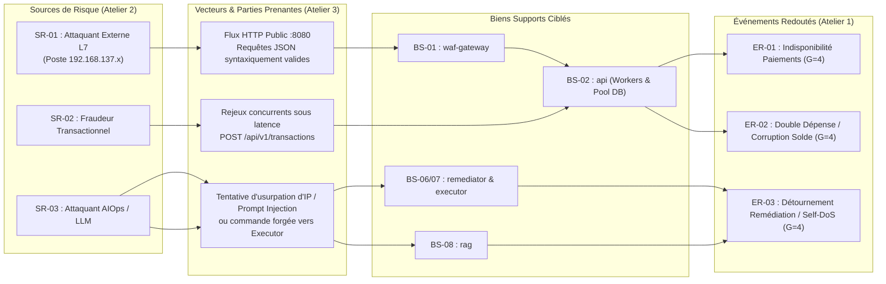

# Analyse de Risques EBIOS Risk Manager (`docs/governance/ebios-rm.md`)

**Projet** : `PROJECT RESILIENCE-ALPHA` — Plateforme de Paiement Conteneurisée & Résilience Autonome (*Zero-Touch Recovery*)  
**Méthodologie** : ANSSI — EBIOS Risk Manager (Guide officiel v1.1)  
**Périmètre** : Architecture microservices conteneurisée (`infra/compose/docker-compose.yml`), chaîne AIOps de détection ML (`IsolationForest`) et d'exécution confinée (`executor`), hébergée sur le PC Hôte `HDV0-INF-P08`.

---

## 1. Atelier 1 — Cadrage et Socle de Sécurité

### 1.1 Missions Critiques et Périmètre de l'Étude
La mission centrale du système étudié est d'**assurer le traitement continu, atomique, exact et auditable des ordres de paiement en euros (calculés en centimes entiers)** entre comptes marchands et partenaires, tout en garantissant une détection et une remédiation autonomes bornées face aux agressions numériques de couche applicative.

- **Périmètre fonctionnel** : Authentification des opérateurs et sondes (`services/auth`), validation et exécution transactionnelle (`services/api`), filtrage périphérique (`services/waf_gateway`), persistance ACID (`postgres`), détection d'anomalies (`services/detector`), orchestration de reprise et preuve métier (`services/remediator`), exécution d'actions de défense (`services/executor`), et assistance documentaire (`services/rag`).
- **Périmètre physique et réseau** : Poste hôte unique `HDV0-INF-P08` (Windows 11 Pro, Intel Core Ultra 9 185H, 31,42 Go RAM, SSD C: avec ~41,4 Go libres) exposant le point d'accès isolé du groupe `RESILIENCE-G<n>` (`192.168.137.1/24`).

### 1.2 Valeurs Métier (VM)

| Réf. | Valeur Métier | Nature | Description et Enjeu Métier | Responsable Métier |
| :--- | :--- | :--- | :--- | :--- |
| **VM-01** | **Traitement des transactions de paiement** | Processus | Exécution synchrone, atomique et idempotente des virements (`POST /api/v1/transactions`) sans double débit ni perte d'écriture. | Direction des Opérations de Paiement |
| **VM-02** | **Intégrité du Grand Livre et des soldes comptables** | Information | Exactitude stricte des soldes en centimes (`balance_cents`), des écritures (`ledger_entries`) et conservation de l'invariant monétaire global (`total_system_balance_cents`). | Direction Financière & Audit Interne |
| **VM-03** | **Journal d'audit de sécurité et preuves de reprise** | Information | Traçabilité immuable des incidents (`INCIDENTS`), des décisions AIOps (`RemediationDecision`), des commandes signées (`audit_chain_hash`) et des preuves de rétablissement (`RecoveryProof`). | RSSI / Direction de la Conformité |
| **VM-04** | **Disponibilité de l'API Métier et du portail SOC** | Processus | Accessibilité continue des services de paiement et de supervision avec une latence P95 nominale inférieure à `100 ms`. | Direction Technique (CTO) |

### 1.3 Cartographie des Biens Supports (BS)

Les valeurs métier reposent directement sur les composants techniques réels de l'architecture `PROJECT RESILIENCE-ALPHA` :

| Réf. | Bien Support | Composant Architecture & Réseau | Valeurs Métier Supportées | Rôle Critique |
| :--- | :--- | :--- | :--- | :--- |
| **BS-01** | Passerelle WAF & Reverse Proxy | `services/waf_gateway` (`:8080`, `edge_net`, `app_net`, `obs_net`, `control_net`) | VM-01, VM-04 | Point d'entrée unique HTTP, filtrage L7 par signatures, liste de blocage dynamique (`dynamic_blocklist`) et limitation de débit (`strict_mitigation`). |
| **BS-02** | API Métier de Paiement | `services/api` (`:8001`, `app_net`, `data_net`, `obs_net`, `control_net`) | VM-01, VM-02, VM-04 | Logique transactionnelle ACID, contrôle d'idempotence (`Idempotency-Key` + `payload_hash`), calcul de rapprochement (`/api/v1/transactions/verify-batch`). |
| **BS-03** | Service d'Authentification JWT | `services/auth` (`:8002`, `app_net`, `data_net`) | VM-01, VM-03 | Émission et vérification des jetons JWT `HS256` et contrôle RBAC (`merchant_operator`, `resilience_probe`, `auditor_readonly`). |
| **BS-04** | Base de Données Transactionnelle | `postgres` (`:5432`, `data_net` isolé `internal: true`) | VM-01, VM-02, VM-03 | Stockage relationnel ACID des comptes, transactions, clés d'idempotence et historiques d'incidents. |
| **BS-05** | Moteur ML de Détection AIOps | `services/detector` (`:8003`, `obs_net`) | VM-03, VM-04 | Collecte télémétrique toutes les 2 s et inférence `IsolationForest` sur 7 caractéristiques (`ml/artifacts/isolation_forest.joblib`). |
| **BS-06** | Orchestrateur d'Incident & Sonde | `services/remediator` (`:8004`, `app_net`, `obs_net`, `control_net`) | VM-01, VM-03, VM-04 | Automate d'états (`NORMAL` $\rightarrow$ `RECOVERED`/`FAILED`), corrélation IP et exécution de la sonde métier post-remédiation. |
| **BS-07** | Exécuteur Confiné d'Administration | `services/executor` (`:8005`, `control_net` isolé `internal: true`) | VM-03, VM-04 | Validation des ordres signés `HMAC-SHA256`, contrôle d'`ALLOWLIST` et application des actions sur `waf-gateway` et `api`. |
| **BS-08** | Assistant Documentaire RAG | `services/rag` (`:8006`, `obs_net`) + Ollama (`gemma4:e4b`) | VM-03 | Aide à la décision opérateur en lecture seule sur la base documentaire Markdown. |
| **BS-09** | Hôte Physique & Stockage Secrets | PC Hôte `HDV0-INF-P08` + `.sops.yaml` / `scripts/secrets_manager.py` | VM-01 à VM-04 | Exécution du moteur de conteneurs, pile réseau locale (`192.168.137.1`) et protection cryptographique des secrets (`JWT_SECRET`, `EXECUTOR_HMAC_SECRET`). |

### 1.4 Socle de Sécurité et État d'Implémentation

| Référentiel / Règle du Socle | Mesure Technique dans `PROJECT RESILIENCE-ALPHA` | Statut |
| :--- | :--- | :---: |
| **Segmentation réseau en zones de confiance** | Découpage Docker Compose en 5 réseaux bridges (`edge_net`, `app_net`, `data_net`, `obs_net`, `control_net`) avec `internal: true` sur les zones sensibles. | **CONFORME** |
| **Confinement des privilèges d'exécution** | Aucun conteneur ne monte `/var/run/docker.sock`. `executor` n'expose qu'une liste fermée de 5 actions validées par Pydantic et signées HMAC-SHA256. | **CONFORME** |
| **Protection des secrets au repos** | Chiffrement des secrets via enveloppe SOPS/Age (`.sops.yaml`, `scripts/secrets_manager.py`) et contrôle automatique par `scripts/secret_scan.py`. | **CONFORME** |
| **Intégrité transactionnelle & Idempotence** | Montants strictement entiers en centimes (`amount_cents`), contrainte unique `idempotency_key` + empreinte `SHA-256` de la requête. | **CONFORME** |
| **Redondance matérielle et géographique** | Déploiement sur un PC Hôte unique (`HDV0-INF-P08`) pour les besoins de la démonstration locale du consortium. | **ÉCART ACCEPTÉ (Prototype)** |

### 1.5 Événements Redoutés (ER)

Échelle de gravité ($G$) : **1** = Négligeable, **2** = Limitée, **3** = Importante, **4** = Critique.

| Code | Valeur Métier | Événement Redouté | Critère DICP | Impacts Métier et Réglementaires | Gravité ($G$) |
| :--- | :--- | :--- | :--- | :--- | :---: |
| **ER-01** | VM-01, VM-04 | **Indisponibilité prolongée du traitement des paiements** (> 30 s en démo / > SLA en production) suite à une saturation applicative. | Disponibilité | Rejet des transactions légitimes, rupture de SLA marchands, perte de chiffre d'affaires et notification d'incident majeur DORA. | **4 (Critique)** |
| **ER-02** | VM-01, VM-02 | **Altération du Grand Livre comptable ou double débit/crédit** lors d'une reprise sur incident ou de requêtes concurrentes. | Intégrité | Perte financière directe, rupture de l'invariant comptable, litiges clients et sanctions de l'autorité de contrôle (ACPR/BCE). | **4 (Critique)** |
| **ER-03** | VM-03, VM-04 | **Prise de contrôle ou détournement de la chaîne de remédiation autonome** (`remediator` / `executor`) provoquant un blocage arbitraire ou une compromission système. | Intégrité / Disponibilité | Auto-déni de service (*Self-DoS* en bloquant la passerelle ou la sonde), exécution de commandes non autorisées, paralysie du SOC. | **4 (Critique)** |
| **ER-04** | VM-03 | **Falsification ou perte du journal d'audit et des preuves de reprise** (`RecoveryProof` / `audit_chain_hash`). | Intégrité / Preuve | Impossibilité de démontrer l'effectivité de la reprise métier aux auditeurs et régulateurs (non-conformité DORA Art. 19 / NIS2 Art. 23). | **3 (Importante)** |
| **ER-05** | VM-03, BS-09 | **Divulgation des secrets cryptographiques** (`JWT_SECRET`, `EXECUTOR_HMAC_SECRET`, identifiants PostgreSQL) ou manipulation de l'assistant RAG. | Confidentialité | Forgerie de jetons administrateurs, émission d'ordres HMAC frauduleux, tromperie de l'opérateur SOC par hallucination ou injection RAG. | **3 (Importante)** |

---

## 2. Atelier 2 — Sources de Risque et Objectifs Visés (SR / OV)

Échelle de cotation : Faible (1), Modérée (2), Élevée (3), Très élevée (4).

| Couple | Source de Risque (SR) | Objectif Visé (OV) | Motivation | Ressources | Activité | Pertinence Retenue | Événements Redoutés Liés |
| :--- | :--- | :--- | :---: | :---: | :---: | :---: | :--- |
| **SR-01 / OV-01** | **Attaquant externe / Activiste ou Concurrent malveillant** (poste distant sur le réseau `RESILIENCE-G<n>`) | **Saturer la couche applicative L7** du moteur de paiement via des requêtes coûteuses syntaxiquement valides pour paralyser les transactions légitimes. | 4 | 2 | 4 | **4/4 (Prioritaire)** | ER-01 |
| **SR-02 / OV-02** | **Fraudeur / Cybercriminel motivé par le gain financier** | **Provoquer une double dépense, un rejeu frauduleux ou une incohérence de solde** en exploitant les délais d'expiration (timeouts) pendant une dégradation de service. | 4 | 3 | 3 | **3/4 (Élevée)** | ER-02, ER-04 |
| **SR-03 / OV-03** | **Attaquant avancé ciblant l'automatisation AIOps & LLM** | **Détourner le mécanisme d'auto-remédiation (`executor`) ou manipuler l'assistant `rag`** afin d'exécuter une action destructrice ou d'induire un *Self-DoS* (blocage d'IP légitime). | 3 | 3 | 3 | **3/4 (Élevée)** | ER-03, ER-05 |
| **SR-04 / OV-04** | **Défaillance technique / Opérateur interne sous pression** | **Épuisement involontaire des ressources du PC Hôte** (`HDV0-INF-P08` : RAM libre ~4,5 Go, disque C: ~41,4 Go) ou mauvaise manipulation en crise. | 1 | 2 | 3 | **2/4 (Modérée)** | ER-01, ER-04 |

---

## 3. Atelier 3 — Scénarios Stratégiques et Cartographie des Parties Prenantes

### 3.1 Évaluation des Parties Prenantes de l'Écosystème

Le niveau de menace d'une partie prenante est calculé selon la formule ANSSI : $\text{Menace} = \frac{\text{Dépendance} \times \text{Pénétration}}{\text{Maturité Cyber} \times \text{Confiance}}$.

| Partie Prenante | Catégorie | Dépendance (1–4) | Pénétration (1–4) | Maturité (1–4) | Confiance (1–4) | Indice de Criticité | Mesure de Maîtrise Écosystème |
| :--- | :--- | :---: | :---: | :---: | :---: | :---: | :--- |
| **Clients / Terminaux API sur `RESILIENCE-G<n>`** | Utilisateurs & Partenaires | 4 | 3 | 2 | 1 | **6,0 (Critique)** | Terminaison obligatoire sur `waf-gateway` (`:8080`), aucun accès direct à `app_net` ou `data_net`. |
| **Moteur LLM Local (Ollama `gemma4:e4b`)** | Fournisseur IA / Modèle | 2 | 2 | 3 | 3 | **0,44 (Faible)** | Isolation de `services/rag` en lecture seule documentaire ; aucun accès à `control_net` ni à `executor`. |
| **Images Conteneurs & Paquets (PyPI / npm / Docker Hub)** | Chaîne d'approvisionnement logicielle | 3 | 3 | 3 | 3 | **1,00 (Modéré)** | Versions figées (`postgres:16-alpine`, `python:3.12-slim`), exécution non-root et absence de socket Docker. |
| **Poste d'Administration / Hôte `HDV0-INF-P08`** | Infrastructure d'hébergement | 4 | 4 | 3 | 3 | **1,78 (Significatif)** | Liaison d'écoute restreinte (`127.0.0.1` / `192.168.137.1`), exclusion stricte du Wi-Fi campus (`10.60.152.94`), secrets chiffrés SOPS. |

### 3.2 Chemins d'Attaque Stratégiques

1. **Scénario Stratégique SS-01 (Déni de service applicatif par contournement des règles statiques)** : L'attaquant externe (SR-01) utilise le réseau Wi-Fi du groupe pour solliciter massivement un point de terminaison métier coûteux en CPU/IO à travers `waf-gateway` (BS-01), saturant les workers de `services/api` (BS-02) et provoquant l'arrêt du traitement des paiements légitimes (ER-01).
2. **Scénario Stratégique SS-02 (Compromission de la boucle de rétroaction AIOps)** : Un attaquant (SR-03) tente soit d'empoisonner les logs/requêtes pour forcer `remediator` (BS-06) à bloquer l'adresse IP de la sonde ou de la passerelle (*Self-DoS*), soit d'injecter des instructions malveillantes dans `rag` (BS-08) ou vers `executor` (BS-07) pour exécuter des actions système arbitraires (ER-03).
3. **Scénario Stratégique SS-03 (Corruption transactionnelle sous stress)** : Pendant la dégradation induite par SS-01, un acteur malveillant (SR-02) bombarde `POST /api/v1/transactions` avec des requêtes rejouées ou des montants flottants/négatifs pour provoquer un état incohérent dans `postgres` (BS-04) et violer l'invariant comptable (ER-02).

---

## 4. Atelier 4 — Scénarios Opérationnels Détaillés et Vraisemblance

Échelle de vraisemblance ($V$) : **1** = Peu vraisemblable, **2** = Vraisemblable, **3** = Très vraisemblable, **4** = Quasi-certain.

### 4.1 Scénario Opérationnel SO-01 (Scénario Principal Démontré) : Saturation L7 sur `/api/v1/transactions/verify-batch`

- **Référence Stratégique** : SS-01 $\rightarrow$ ER-01 ($G = 4$).
- **Mode opératoire détaillé (Kill Chain)** :
  1. **Reconnaissance** : Depuis le PC Attaquant (`192.168.137.x`), l'adversaire identifie l'ouverture du port `:8080` (`waf-gateway`) et repère l'endpoint de contrôle intensif `/api/v1/transactions/verify-batch`.
  2. **Armement (Contournement WAF statique)** : L'attaquant construit des charges utiles JSON strictement conformes au schéma métier (sans chaîne SQLi `UNION SELECT` ni balise `<script>`). Les signatures statiques du WAF laissent passer ces requêtes légitimes en apparence.
  3. **Action sur l'objectif (Exploitation)** : Envoi d'une rafale soutenue et bornée (ex. > 60 req/s) sur `/api/v1/transactions/verify-batch`.
  4. **Effet technique observable** : Le ratio `expensive_endpoint_ratio` dépasse `0.90`, `cpu_worker_saturation` atteint `0.96`, et la latence P95 (`latency_p95_ms`) bondit au-delà de `800 ms`, provoquant l'échec ou le ralentissement critique des paiements `POST /api/v1/transactions`.
- **Cotation de vraisemblance** :
  - *Sans chaîne AIOps (WAF statique seul)* : **$V_{\text{initial}} = 4$ (Quasi-certain)** — aucun mécanisme par signature ne bloque un appel métier syntaxiquement valide.
  - *Avec détection ML `IsolationForest` + remédiation dynamique* : **$V_{\text{résiduel}} = 1$ (Peu vraisemblable)** pour une attaque mono-source, car l'anomalie multivariée est détectée en `< 5 s`, l'IP dominante est bloquée dynamiquement en bordure (`block_ip_waf`) et les workers sont recyclés (`recycle_api_workers`).

### 4.2 Scénario Opérationnel SO-02 : Détournement de `services/executor` ou Injection Indirecte via `services/rag`

- **Référence Stratégique** : SS-02 $\rightarrow$ ER-03 ($G = 4$) / ER-05 ($G = 3$).
- **Mode opératoire détaillé** :
  1. **Vecteur A (Attaque directe ou rejeu sur l'exécuteur)** : Un attaquant ou un conteneur compromis tente d'appeler `POST /executor/v1/execute` pour lancer une commande shell (`; rm -rf /`) ou réutiliser un ancien ordre capturé.
  2. **Vecteur B (Usurpation / Self-DoS)** : L'attaquant injecte des en-têtes `X-Forwarded-For: 127.0.0.1` ou `172.28.10.1` afin que `remediator` ordonne le blocage de sa propre sonde métier ou de la passerelle Docker.
  3. **Vecteur C (Prompt Injection sur le RAG)** : L'attaquant soumet une question piégée à `/rag/v1/query` demandant à l'agent LangChain/Ollama d'appeler `executor` pour désactiver le WAF.
- **Barrières architecturales opposées** :
  - `executor` est isolé sur `control_net` (`internal: true`), vérifie la signature `HMAC-SHA256` et la fenêtre temporelle (`<= 30 s`), rejette tout métacaractère shell (`403 Forbidden`), n'exécute qu'une `ALLOWLIST` de 5 fonctions Python préprogrammées sans socket Docker, et protège par liste blanche les IP internes (`127.0.0.1`, passerelles Docker).
  - `rag` est isolé sur `obs_net` uniquement : il ne possède ni client HTTP vers `control_net`, ni secret HMAC, ni outil d'exécution LangChain.
- **Cotation de vraisemblance** :
  - *Sans confinement* : **$V_{\text{initial}} = 3$ (Très vraisemblable)**.
  - *Avec confinement architectural* : **$V_{\text{résiduel}} = 1$ (Peu vraisemblable)**.

### 4.3 Scénario Opérationnel SO-03 : Rejeu Transactionnel et Falsification Monétaire en Période de Crise

- **Référence Stratégique** : SS-03 $\rightarrow$ ER-02 ($G = 4$).
- **Mode opératoire détaillé** :
  1. Pendant que l'API subit un pic de latence (transition `INCIDENT` $\rightarrow$ `REMEDIATING`), un client ou attaquant renvoie en boucle la même requête `POST /api/v1/transactions` ou modifie le montant à la volée avec la même clé `Idempotency-Key`, ou tente d'injecter des flottants (`25.0000001`) / montants négatifs (`-5000`).
- **Barrières architecturales opposées** :
  - Validation Pydantic stricte (`isinstance(amount_cents, int)` et `1 <= amount_cents <= 10_000_000`).
  - Transaction SQL atomique vérifiant le couple `(idempotency_key, payload_hash)` : si le hash SHA-256 est identique, renvoi de la réponse mise en cache (`X-Idempotent-Replay: true`) sans toucher aux soldes ; si le hash diffère pour la même clé, rejet immédiat `409 Conflict`.
- **Cotation de vraisemblance** :
  - *Sans idempotence atomique* : **$V_{\text{initial}} = 3$ (Très vraisemblable)**.
  - *Avec verrouillage ACID et centimes entiers* : **$V_{\text{résiduel}} = 1$ (Peu vraisemblable)**.

---

## 5. Atelier 5 — Traitement du Risque et Matrice des Risques Résiduels

### 5.1 Synthèse du Traitement des Risques (Avant / Après Mesures)

| Scénario | Événement Redouté | $G$ | $V_{\text{init}}$ | Risque Initial | Mesures de Sécurité Implémentées dans le Démonstrateur | $V_{\text{rés}}$ | Risque Résiduel | Décision |
| :--- | :--- | :---: | :---: | :---: | :--- | :---: | :---: | :--- |
| **SO-01** | ER-01 (Indisponibilité Paiements L7) | 4 | 4 | **EXTRÊME (16)** | Inférence `IsolationForest` (2 fenêtres), corrélation IP WAF, `block_ip_waf` (TTL 300s), profil `strict_mitigation`, recyclage workers et sonde `RecoveryProof`. | 1 | **MODÉRÉ (4)** | **Retenu & Démontré** |
| **SO-02** | ER-03 / ER-05 (Détournement AIOps / RAG) | 4 | 3 | **EXTRÊME (12)** | Réseau `control_net` interne, signature `HMAC-SHA256` + anti-rejeu 30s, `ALLOWLIST` stricte sans Docker socket, IP protégées, `rag` 100 % lecture seule, journal chaîné `audit_chain_hash`. | 1 | **MODÉRÉ (4)** | **Réduit & Confiné** |
| **SO-03** | ER-02 (Double dépense / Corruption solde) | 4 | 3 | **EXTRÊME (12)** | Calculs exclusifs en centimes entiers (`amount_cents`), table `idempotency_keys` avec `payload_hash` SHA-256, transactions PostgreSQL ACID et vérification de l'invariant monétaire. | 1 | **MODÉRÉ (4)** | **Réduit & Testé** |
| **SO-04** | ER-04 (Perte d'audit ou bouclage infini) | 3 | 3 | **ÉLEVÉ (9)** | Garde-fous d'automate (`MAX_ATTEMPTS = 3`, `COOLDOWN_SECONDS = 15`), bascule explicite en état `FAILED` pour escalade humaine, chaîne de hachage d'audit. | 1 | **FAIBLE (3)** | **Réduit & Supervisé** |

### 5.2 Matrice Explicite des Risques Résiduels (Transparence Architecturale)

Conformément à l'exigence de rigueur d'ingénierie du projet, le démonstrateur ne prétend pas éliminer tous les risques. Les **4 risques résiduels suivants sont explicitement identifiés, documentés et transmis au Comité de Direction** pour la phase d'industrialisation :

| Réf. | Intitulé du Risque Résiduel | Cause Technique dans le Prototype | Impact Potentiel | Niveau Résiduel | Plan de Traitement Cible (Industrialisation) |
| :--- | :--- | :--- | :--- | :---: | :--- |
| **RR-01** | **Point de défaillance unique matériel (SPOF PC Hôte `HDV0-INF-P08`) et pression ressources** | Toute l'architecture Docker Compose et la base `postgres` tournent sur un seul poste physique disposant d'environ `4,5 Go` de RAM libre et `41,4 Go` de disque libre sur `C:`. | Une panne électrique, un crash de Windows 11 / Docker Desktop ou la saturation du disque `C:` entraîne l'arrêt total du service et du SOC. | **ÉLEVÉ** | Migration vers un cluster Kubernetes multi-zones (3 nœuds minimum) avec réplication synchrone PostgreSQL (Patroni/CloudNativePG) et stockage redondé. |
| **RR-02** | **Contournement du blocage IP par un Botnet distribué ou effet collatéral derrière un NAT partagé** | La remédiation `block_ip_waf` cible l'adresse IP dominante (`dominant_source_ip`) tout en activant `strict_mitigation`. Face à des milliers d'IP distribuées (faible volume par IP), le blocage unitaire est insuffisant ; inversement, bloquer une IP de passerelle NAT d'entreprise bloque tous les clients derrière ce NAT pendant 300 s. | Maintien d'une dégradation partielle sous attaque DDoS très distribuée, ou faux positifs temporaires (5 min) pour des utilisateurs partageant une IP publique. | **MODÉRÉ** | Déploiement d'un WAF Anycast en bordure CDN avec empreinte TLS (JA3/JA4), jetons de preuve de travail (JS Challenge / WebAuthn) et limitation de débit par compte (`sub` JWT) plutôt que par seule IP. |
| **RR-03** | **Dérive du modèle ML (`Concept Drift`) et attaque lente (*Low-and-Slow*)** | Le modèle `IsolationForest` est entraîné hors ligne sur un jeu de données stationnaire (`ml/artifacts/isolation_forest.joblib`). Lors d'un événement commercial légitime exceptionnel (ex. Black Friday) ou d'une attaque très progressive, le seuil fixe (`-0.0850`) peut générer des faux positifs ou des faux négatifs. | Déclenchement intempestif du profil `strict_mitigation` lors d'un pic d'activité légitime, ou non-détection d'une dégradation insidieuse. | **MODÉRÉ** | Mise en place d'un pipeline MLOps avec détection de dérive statistique (PSI / KS-test), seuils adaptatifs saisonniers et validation humaine (*Human-in-the-Loop*) du réentraînement. |
| **RR-04** | **Saturation volumétrique réseau (L3/L4) en amont de `waf-gateway`** | Le filtrage dynamique s'effectue au niveau HTTP (L7) dans le conteneur `waf-gateway` sur l'hôte `192.168.137.1`. Si le lien Wi-Fi du point d'accès mobile Windows est saturé par un flood UDP/SYN massif, les paquets n'atteignent plus sainement l'application. | Indisponibilité réseau périphérique que le recyclage de conteneurs locaux ne peut pas résorber. | **MODÉRÉ** | Absorption DDoS L3/L4 opérateur en amont (Scrubbing Center BGP / Anycast) avant routage vers l'infrastructure applicative. |
