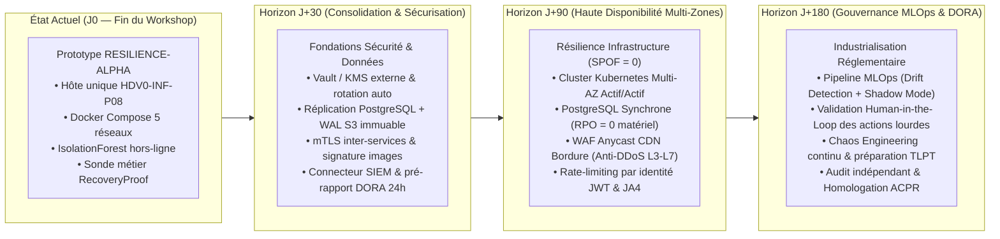

# Note d'Arbitrage Exécutif et Feuille de Route d'Industrialisation — COMEX (`docs/governance/executive-recommendations.md`)

**Destinataires** : Comité Exécutif (Direction Générale, Direction des Opérations de Paiement, Direction des Risques & Conformité, DSI / CTO, RSSI)  
**Objet** : Bilan des arbitrages d'architecture du démonstrateur **PROJECT RESILIENCE-ALPHA** (Sprint de 4 jours) et plan d'investissement priorisé à **30 / 90 / 180 jours** pour le passage en production bancaire sous régime DORA.

---

## 1. Synthèse Exécutive (Executive Summary)

Le démonstrateur **PROJECT RESILIENCE-ALPHA** prouve techniquement qu'une plateforme de paiement soumise à une attaque applicative ciblée de couche 7 (contournant les pare-feux statiques traditionnels) peut :
1. **Détecter l'anomalie en moins de 5 secondes** par apprentissage automatique non supervisé (`IsolationForest`) sans dépendre de signatures préexistantes ;
2. **Contenir la menace et assainir le service sans intervention humaine (*Zero-Touch Recovery*)** via un canal d'exécution cryptographiquement confiné (`HMAC-SHA256` + liste fermée d'actions) ;
3. **Prouver mathématiquement et fonctionnellement la reprise** non pas par un simple indicateur technique, mais par une **nouvelle transaction monétaire réelle en centimes, atomique, idempotente et vérifiée dans le Grand Livre (`RecoveryProof`)**.

Toutefois, la réussite de ce démonstrateur sur un poste hôte unique (`HDV0-INF-P08`) ne doit pas masquer le fossé qui sépare un **prototype d'ingénierie de 4 jours** d'une **infrastructure de paiement de classe industrielle**. La présente note expose en toute transparence les arbitrages réalisés pendant le sprint et soumet à l'approbation du COMEX la trajectoire d'industrialisation à 180 jours.

---

## 2. Arbitrages Réalisés sous Contrainte de 4 Jours et Justifications

Face aux contraintes de temps (4 jours) et aux ressources matérielles auditées sur le PC Hôte `HDV0-INF-P08` (`31,42 Go` de RAM totale dont `~4,5 Go` disponibles à l'audit, `41,46 Go` d'espace libre sur le disque `C:`, démon Docker local sous Windows 11), cinq arbitrages structurants ont été arrêtés :

| Domaine | Choix Retenu pour le Sprint (4 Jours) | Alternative Écartée | Justification Technique, Sécurité et Métier |
| :--- | :--- | :--- | :--- |
| **1. Moteur de Détection AIOps** | **`IsolationForest` (`scikit-learn`) sur 7 métriques métier/système explicables** | Réseau de neurones profond (LSTM / Autoencodeur PyTorch) | **Sobriété & Explicabilité** : `IsolationForest` s'exécute en `< 5 ms` sur CPU (`0.50 vCPU`, `256 Mo RAM`), ne consomme pas la VRAM du GPU et permet d'exposer immédiatement au SOC et à l'auditeur DORA les 3 variables explicatives (`top_contributing_features`). |
| **2. Exécution des Actions de Remédiation** | **Microservice `executor` sans privilège Docker, commandé par `HMAC-SHA256` + `ALLOWLIST` stricte** | Montage de `/var/run/docker.sock` dans `remediator` ou `executor` | **Sécurité par conception** : Monter le socket Docker équivaut à donner un accès `root` total sur l'hôte en cas de compromission d'un conteneur. L'API d'administration interne signée HMAC permet de bloquer une IP et de recycler les workers sans jamais exposer le démon Docker. |
| **3. Rôle de l'IA Générative (LLM)** | **Assistant `services/rag` (Ollama `gemma4:e4b` local) 100 % consultatif en lecture seule** | Agent LLM autonome décidant et exécutant les commandes de remédiation | **Maîtrise du risque opérationnel** : Un LLM est probabiliste, sensible aux hallucinations et au *Prompt Injection* (latence de plusieurs secondes). Confier le blocage réseau ou le recyclage d'une API de paiement à un LLM violerait l'exigence de déterminisme DORA Art. 11. |
| **4. Orchestration & Topologie Hôte** | **Docker Compose multi-réseaux (5 bridges isolés) + Playbooks Ansible sur hôte unique `HDV0-INF-P08`** | Cluster Kubernetes multi-nœuds complet sur machines virtuelles lourdes | **Pragmatisme & Empreinte Disque/RAM** : Avec `~4,5 Go` de RAM libre et `41,4 Go` de disque libre, un cluster K8s multi-VM aurait saturé l'hôte et compromis la stabilité de la démonstration. Le budget conteneurs a été plafonné à `~2,45 Go` de RAM et `~1,5 Go` d'images Alpine/Slim. |
| **5. Gestion des Secrets** | **Enveloppe chiffrée SOPS/Age (`.sops.yaml` + `scripts/secrets_manager.py`) et scan CI (`secret_scan.py`)** | HSM matériel dédié ou cluster HashiCorp Vault externe | **Portabilité & Zéro Secret en Clair** : Garantit qu'aucune clé privée ni fichier `.env` en clair n'est commité dans Git ou livré dans l'archive `.zip`, tout en fonctionnant sans infrastructure tierce externe. |

---

## 3. Feuille de Route d'Industrialisation Priorisée (30 / 90 / 180 Jours)

### 3.1 Horizon J+30 : Consolidation Cryptographique, Sauvegarde Hôte et Intégration SOC (Priorité P0)
*Objectif : Éliminer les vulnérabilités immédiates liées à l'exploitation quotidienne sans attendre la refonte d'infrastructure.*

1. **Externalisation des secrets dans un KMS / HashiCorp Vault HA** :
   - Remplacement de l'injection par variables d'environnement au démarrage par des secrets dynamiques à bail court (*short-lived leases*), avec rotation automatique hebdomadaire de `JWT_SECRET` et `EXECUTOR_HMAC_SECRET`.
2. **Protection contre la perte du disque local (`RR-01` partiel)** :
   - Mise en place d'un réplica PostgreSQL asynchrone hors hôte et archivage continu des journaux de transactions (WAL shipping) vers un stockage objet immuable (S3 Object Lock / WORM) garantissant un $RPO \le 30\text{ s}$ en cas de crash physique.
3. **Chiffrement interne mTLS et Chaîne d'Approvisionnement Logicielle (NIS2 Art. 21 d)** :
   - Activation de TLS mutuel (mTLS) sur `app_net`, `data_net` et `control_net` en complément de la signature applicative `HMAC-SHA256`.
   - Génération automatique du SBOM (*Software Bill of Materials*), scan de vulnérabilités Trivy bloquant en CI et signature cryptographique des images Docker (Cosign).
4. **Automatisation du pré-remplissage réglementaire DORA (Art. 19)** :
   - Transformation automatique des objets `INCIDENTS` et `RecoveryProof` en formulaires réglementaires pré-remplis pour la notification initiale (4h/24h) et intermédiaire (72h), soumis à validation du RSSI.

### 3.2 Horizon J+90 : Architecture Multi-Zones Actif/Actif et Défense Périphérique Distribuée (Priorité P1)
*Objectif : Éliminer le SPOF matériel (`RR-01`), le risque de saturation volumétrique L3/L4 (`RR-04`) et le contournement par botnet distribué (`RR-02`).*

1. **Migration de Docker Compose mono-hôte vers Kubernetes Multi-Zones (3 AZ Actif/Actif)** :
   - Déploiement des microservices sur au moins 3 zones de disponibilité indépendantes électriquement et géographiquement.
   - Traduction des 5 réseaux bridges Docker en `NetworkPolicies` Kubernetes strictes (Calico / Cilium eBPF) appliquant exactement la même matrice de flux zéro-confiance.
2. **Base Transactionnelle à Réplication Synchrone ($RPO = 0$ matériel, $RTO < 15\text{ s}$ sur perte de nœud)** :
   - Déploiement d'un cluster PostgreSQL hautement disponible (CloudNativePG / Patroni) avec au moins 1 réplica synchrone sur une seconde zone : aucune transaction de paiement n'est acquittée (`201 Created`) sans écriture confirmée sur au moins deux zones distinctes.
3. **WAF Anycast en Bordure CDN et Mitigation Anti-Botnet (`RR-02` & `RR-04`)** :
   - Déport du filtrage initial vers une bordure Anycast opérateur capable d'absorber les attaques volumétriques L3/L4 (UDP/SYN flood) avant l'entrée du datacenter.
   - Enrichissement de `executor` : au lieu de bloquer uniquement une adresse IPv4 (risque d'effet collatéral derrière un NAT partagé ou d'inefficacité face à 50 000 IP), l'action de remédiation applique un filtrage par empreinte TLS (`JA4`), par jeton utilisateur (`sub` JWT) et par défi cryptographique adaptatif.

### 3.3 Horizon J+180 : Gouvernance MLOps (*Human-in-the-Loop*) et Résilience Réglementaire DORA (Priorité P2)
*Objectif : Maîtriser la dérive du modèle ML (`RR-03`), encadrer humainement les actions à fort impact et valider la conformité DORA Chapitre IV.*

1. **Gouvernance MLOps et Détection de Dérive (*Concept Drift*)** :
   - Surveillance continue de la distribution des 7 caractéristiques d'entrée (indice de stabilité de population PSI et test de Kolmogorov-Smirnov) pour détecter les changements légitimes de saisonnalité (soldes, fêtes de fin d'année).
   - Déploiement de tout nouveau modèle `IsolationForest` en **mode fantôme (*Shadow Mode*)** pendant 14 jours parallèlement au modèle actif avant mise en production.
2. **Gouvernance *Human-in-the-Loop* Graduée (Autonomie Bornée par Criticité)** :
   - **Niveau 1 (100 % Autonome — *Zero-Touch*)** : Actions réversibles et à portée bornée (`block_ip_waf` unitaire avec TTL 300 s, `set_rate_limit_profile`, `recycle_api_workers`, exécution de la sonde `RecoveryProof`).
   - **Niveau 2 (Validation Humaine en 1 clic — *Human-in-the-Loop*)** : Toute action à impact étendu ou potentiellement destructrice (blocage d'un sous-réseau entier `/16`, révocation globale des sessions JWT, bascule forcée de base de données primaire, gel d'un compte marchand `FROZEN`, ou mise en production d'un modèle ML réentraîné) exige une double validation cryptographique d'un opérateur SOC N2 et du RSSI d'astreinte.
3. **Programme de Chaos Engineering et Préparation aux Tests TLPT (DORA Art. 26)** :
   - Automatisation hebdomadaire des tirs de résilience contrôlés en pré-production et qualification d'un prestataire Red Team externe indépendant pour les tests fondés sur la menace (cadre TIBER-EU).

---

## 4. Chiffrage Budgétaire Indicatif et Retour sur Investissement (ROI)

| Phase de la Feuille de Route | Délai | Charge Humaine Estimée | Budget Infrastructure & Licences (OPEX Annuel) | Budget Projet / Audit (CAPEX) | Risques Écartés & Valeur Métier Créée |
| :--- | :---: | :---: | :---: | :---: | :--- |
| **Phase 1 : Consolidation & Vault** | **J+30** | 25 jours-hommes (SecOps + DBA) | + 18 000 € / an | 20 000 € | Suppression du risque de perte de données sur crash disque et conformité cryptographique NIS2 Art. 21. |
| **Phase 2 : Multi-AZ & WAF Bordure** | **J+90** | 60 jours-hommes (SRE + Réseau + Backend) | + 72 000 € / an | 50 000 € | Élimination du SPOF matériel (`RR-01`), résilience anti-DDoS distribué (`RR-02`/`RR-04`), SLA 99,99 % garanti aux marchands. |
| **Phase 3 : MLOps, HITL & Audit DORA** | **J+180** | 45 jours-hommes (Data/ML + GRC + RSSI) | + 24 000 € / an | 65 000 € *(incl. audit externe)* | Maîtrise du *Concept Drift* (`RR-03`), piste d'audit complète pour l'ACPR et évitement des sanctions DORA (jusqu'à 1 % du CA quotidien mondial) et NIS2 (jusqu'à 10 M€ ou 2 % du CA). |
| **TOTAL INDUSTRIALISATION (6 MOIS)** | **180 jours** | **130 j/h** | **114 000 € / an** | **135 000 €** | **Coût total de 1re année (~249 k€) inférieur au coût métier d'une seule panne majeure de 3 heures (~330 k€ de commissions et pénalités directes).** |

---

## 5. Décisions Soumises à l'Approbation du COMEX

1. **Validation du principe de Preuve Métier Obligatoire (`RecoveryProof`)** comme standard interne groupe : aucun incident de production ne pourra plus être clôturé sur la seule foi d'une sonde technique `/health` sans validation d'une transaction de bout en bout.
2. **Approbation de la matrice des 4 risques résiduels (`RR-01` à `RR-04`)** identifiés sur le démonstrateur et interdiction de mise en production commerciale sur un nœud unique avant l'achèvement du jalon **J+90**.
3. **Validation de la doctrine d'usage de l'IA** : maintien strict de la séparation entre **IA analytique déterministe** (`IsolationForest` supervisé par des règles bornées pour la détection) et **IA générative consultative** (RAG en lecture seule sans privilège d'exécution).
