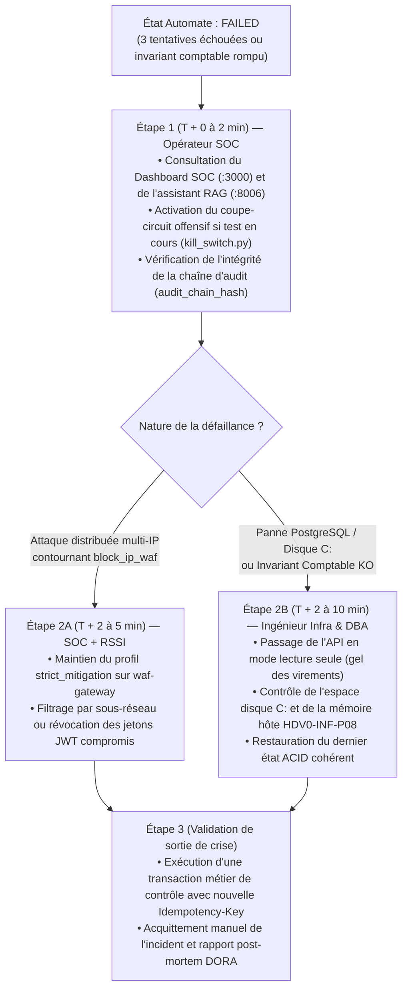

# Plan de Continuité et de Reprise d'Activité — PCA / PRA (`docs/governance/pca-pra.md`)

**Projet** : `PROJECT RESILIENCE-ALPHA` — Plateforme de Paiement Conteneurisée & Résilience Autonome  
**Référentiels** : ISO 22301 (Systèmes de management de la continuité d'activité), DORA Art. 11 & 12 (Politique de continuité des activités TIC et plans de réponse et de rétablissement)  
**Principe Directeur** : Distinguer avec une rigueur absolue la **reprise autonome applicative locale (*Zero-Touch Recovery*)** démontrée sur le prototype et un **PCA/PRA d'entreprise complet** couvrant les sinistres matériels, l'infrastructure physique et la corruption de données.

---

## 1. Analyse d'Impact Métier (BIA — *Business Impact Analysis*)

### 1.1 Coût Métier de l'Indisponibilité d'une Fonction de Paiement
Pour un établissement de paiement ou un prestataire de services de paiement (PSP) traitant en moyenne `50 transactions/seconde` d'un panier moyen de `45,00 €` (`4 500 centimes`), toute interruption ou dégradation sévère (latence P95 > `800 ms` provoquant l'abandon ou le timeout client) entraîne des impacts cumulatifs immédiats :

| Durée d'Interruption | Perte de Volume Transactionnel Brut Estimée |Perte de Commissions Directes (Frais PSP ~1,2 %) | Pénalités SLA Marchands & Coûts Opérationnels | Impact Réglementaire & Réputationnel |
| :--- | :---: | :---: | :---: | :--- |
| **< 15 secondes** *(Cible Zero-Touch)* | ~33 750 € (absorbé par rejeu idempotent client) | < 50 € | 0 € (sous le seuil de franchise SLA) | Transparent pour l'utilisateur final grâce au mécanisme d'`Idempotency-Key`. |
| **5 minutes** | ~675 000 € | ~8 100 € | ~5 000 € (avoirs commerciaux) | Premières plaintes sur les réseaux sociaux et alerte N2 SOC. |
| **1 heure** | ~8,10 M€ | ~97 200 € | ~45 000 € (rupture SLA 99,9 %) | **Seuil d'incident majeur TIC (DORA Art. 19)** : obligation de notification initiale à l'autorité compétente (ACPR). |
| **4 heures** | ~32,40 M€ | ~388 800 € | > 200 000 € + résiliation de contrats marchands | Crise médiatique, perte de confiance durable, audit réglementaire sur site. |

### 1.2 Critique Métier des Fonctions du Système

| Fonction Métier | Composants Supports (`docker-compose.yml`) | Criticité | Tolérance Maximale à l'Interruption (MTPD) | Exigence d'Intégrité au Redémarrage |
| :--- | :--- | :---: | :---: | :--- |
| **Exécution et validation des paiements** | `waf-gateway`, `api`, `auth`, `postgres` | **Vitale (P0)** | Quelques secondes (cible < 15 s sur incident L7) | **Zéro perte de transaction confirmée (`COMMITTED`)**, zéro double débit, conservation exacte de `total_system_balance_cents`. |
| **Détection et Remédiation Autonome AIOps** | `detector`, `remediator`, `executor` | **Critique (P1)** | < 30 secondes | Journalisation intègre (`audit_chain_hash`) et arrêt sûr en état `FAILED` après 3 échecs. |
| **Supervision Opérateur & Observabilité** | `frontend`, `prometheus`, `loki`, `grafana` | **Importante (P2)** | 15 minutes | Continuité de la collecte des métriques RED et des journaux structurés. |
| **Assistance Documentaire IA (RAG)** | `rag` + Ollama (`gemma4:e4b`) | **Secondaire (P3)** | 4 heures | Fonction purement consultative : sa panne ne bloque ni les paiements ni la remédiation automatique. |

---

## 2. Distinction Rigoureuse : Objectifs Cibles (RTO/RPO) vs Mesures Observées (MTTD/MTTR)

> [!IMPORTANT]
> Conformément aux règles d'ingénierie de **PROJECT RESILIENCE-ALPHA**, il est interdit de confondre un **objectif contractuel de continuité (RTO/RPO)** avec une **mesure expérimentale de temps de détection et de remédiation applicative (MTTD/MTTR)** relevée lors d'un test sur un poste unique.

| Indicateur | Définition Normative | Valeur Cible d'Architecture (Objectif) | Valeur Technique Observée sur le Démonstrateur (`RecoveryProof`) | Portée et Limite d'Interprétation |
| :--- | :--- | :--- | :--- | :--- |
| **MTTD** (*Mean Time To Detect*) | Temps écoulé entre le début de la dégradation observable (T2) et la confirmation de l'incident par le moteur ML (T3). | **$\le 10\text{ s}$** (2 fenêtres d'observation de 2 à 5 s) | **Mesuré dynamiquement** dans `RecoveryProof.mttd_seconds` (typiquement `~4,0 à 6,0 s`). | Mesure réelle de la réactivité du couple `detector` (`IsolationForest`) + `remediator` (confirmation sur 2 fenêtres consécutives). |
| **MTTR Applicatif** (*Mean Time To Recover/Remediate*) | Temps écoulé entre la confirmation de l'incident (T3) et la validation complète de la sonde métier post-remédiation (T5). | **$\le 10\text{ s}$** (exécution HMAC + recyclage + sonde transactionnelle) | **Mesuré dynamiquement** dans `RecoveryProof.mttr_seconds` (typiquement `~3,0 à 5,0 s`). | Mesure réelle incluant : blocage IP WAF (`block_ip_waf`), profil `strict_mitigation`, recyclage des workers API et **persistance vérifiée d'une transaction de preuve (`100` centimes)**. |
| **RTO** (*Recovery Time Objective*) | Durée maximale acceptable d'interruption de service après un sinistre avant impact métier sévère. | **$\le 15\text{ s}$** (incident applicatif L7 local) / **$\le 15\text{ min}$** (reconstruction complète de la pile sur hôte de secours) | **$\sim 7,5\text{ s}$** sur le scénario L7 démontré (`total_incident_duration_seconds`) ; **Non automatisé** en cas de panne physique du PC Hôte. | Sur le démonstrateur, le RTO de `< 15 s` est prouvé uniquement pour les incidents logiciels/applicatifs L7. Une panne matérielle de `HDV0-INF-P08` nécessite un redéploiement manuel via Ansible/Docker Compose. |
| **RPO** (*Recovery Point Objective*) | Âge maximal des données pouvant être perdues lors d'un sinistre. | **$0\text{ octet}$ ($RPO = 0$)** pour une défaillance applicative ; **$\le 5\text{ min}$** en cas de perte du disque physique sans réplication synchrone. | **$0\text{ transaction perdue}$** lors du scénario démontré (validation ACID PostgreSQL + idempotence). | Tant que le volume Docker PostgreSQL sur le SSD `C:` est intact, $RPO = 0$ grâce au journal des transactions (WAL). Si le disque `C:` du PC Hôte est détruit, les données non sauvegardées hors hôte sont perdues. |

---

## 3. Scénarios Couverts par la Reprise Autonome (*Zero-Touch Recovery*)

La boucle autonome implémentée par `detector` $\rightarrow$ `remediator` $\rightarrow$ `executor` couvre de bout en bout les scénarios de dégradation applicative et d'épuisement de ressources logicielles suivants :

### 3.1 Scénario Couvert Nominal : Épuisement Applicatif L7 (`/api/v1/transactions/verify-batch`)
1. **Détection (T3)** : Le service `detector` calcule toutes les 2 secondes le vecteur à 7 caractéristiques (`req_rate_rps`, `latency_p95_ms`, `error_rate_ratio`, `expensive_endpoint_ratio`, `unique_ip_entropy`, `cpu_worker_saturation`, `tx_success_ratio`). Après **2 fenêtres consécutives** où le score `IsolationForest` est inférieur au seuil calibré (`-0.0850`), `remediator` passe de `SUSPECT` à `INCIDENT`.
2. **Isolation Périphérique et Assainissement Interne (T4)** :
   - Corrélation automatique des journaux structurés du WAF pour extraire `dominant_source_ip` (ex. `192.168.137.x`).
   - Émission d'ordres signés `HMAC-SHA256` sur `control_net` vers `services/executor` :
     * `block_ip_waf` : mise en quarantaine immédiate de l'IP attaquante dans la `dynamic_blocklist` du WAF pour `300 s` (rejet HTTP 403/429 en `< 1 ms`).
     * `set_rate_limit_profile` : activation du profil `strict_mitigation` pendant `300 s`.
     * `recycle_api_workers` & `reset_connection_pool` : purge contrôlée des workers saturés et réinitialisation du pool de connexions SQL de `services/api`.
3. **Vérification Métier de Bout en Bout (T5 — Preuve Obligatoire)** :
   - **Un simple `/health` à `200 OK` ou un redémarrage de conteneur est explicitement refusé comme preuve de reprise.**
   - Pour passer de `VERIFYING` à `RECOVERED`, `services/remediator` doit :
     1. Obtenir un jeton JWT valide (`role: resilience_probe`) auprès de `services/auth` ;
     2. Exécuter `POST /api/v1/transactions` à travers `waf-gateway` avec un montant de `100` centimes (`1,00 €`) et la clé `probe-recovery-<incident_id>-attempt-<n>` ;
     3. Vérifier la persistance réelle via `GET /api/v1/transactions/<tx_id>` (`status == "COMMITTED"`) ;
     4. Rejouer la même requête avec la même `Idempotency-Key` pour vérifier la protection anti-doublon (`idempotent_replay == true`) ;
     5. Contrôler que l'invariant comptable `total_system_balance_cents` est préservé et que la latence post-reprise est redevenue nominale (`< 100 ms`).

---

## 4. Scénarios NON Couverts par un Simple Redémarrage de Conteneurs (Limites Explicites du Prototype)

> [!WARNING]
> **Règle d'Architecture Majeure** : Un recyclage de workers applicatifs ou un redémarrage de conteneur Docker ne constitue **JAMAIS** un Plan de Continuité d'Activité (PCA) complet. Le tableau ci-dessous recense les sinistres face auxquels l'automate local est inopérant et précise les procédures de secours associées.

| Scénario de Sinistre Non Couvert par `executor` | Pourquoi le Recyclage / Redémarrage de Conteneur Échoue | Procédure de Reprise Prévue (PRA Manuel / Cible Industrielle) |
| :--- | :--- | :--- |
| **1. Panne matérielle, électrique ou crash OS du PC Hôte unique (`HDV0-INF-P08`)** | Tous les conteneurs (`waf-gateway`, `api`, `postgres`, `remediator`, `executor`) partagent le même noyau et le même matériel physique. Si l'hôte tombe, l'automate de remédiation tombe avec lui. | **Sur le workshop** : Redéploiement de l'infrastructure codée via `infra/ansible/site.yml` et `scripts/up.ps1` sur un second poste du groupe (RTO ~10–15 min). **En production** : Cluster Kubernetes multi-AZ actif/actif avec bascule DNS/Anycast automatique. |
| **2. Saturation ou corruption du disque SSD `C:` (~41,4 Go libres) ou de la RAM hôte (~4,5 Go libres)** | Redémarrer un conteneur sur un disque plein à 100 % ou en condition d'*Out-Of-Memory* (OOM) hôte échoue immédiatement ou corrompt les fichiers journaux (WAL) de PostgreSQL. | Prévention par limites strictes `mem_limit` (`~2,45 Go` cumulés) dans `docker-compose.yml` et rotation des logs JSON. En cas de corruption du volume `postgres`, restauration à partir d'un export logique signé (`pg_dump`) sur volume externe. |
| **3. Compromission logique de la base PostgreSQL ou corruption du Grand Livre** | Si une donnée en base est corrompue ou si un schéma SQL est altéré, redémarrer `services/api` ne restaure pas l'intégrité des soldes (`balance_cents`) : l'application redémarre sur des données fausses. | Détection immédiate par l'échec du contrôle `accounting_invariant_verified` de la sonde métier $\rightarrow$ passage de l'automate à l'état `FAILED`, gel des écritures et restauration granulaire Point-in-Time Recovery (PITR) par le DBA. |
| **4. Fuite ou compromission des secrets cryptographiques (`JWT_SECRET`, `EXECUTOR_HMAC_SECRET`)** | Un redémarrage de conteneur conserve les mêmes variables d'environnement compromises. L'attaquant peut continuer à signer des jetons JWT ou des ordres `ExecutorCommand`. | Révocation et rotation d'urgence des clés via `scripts/secrets_manager.py` (chiffré SOPS/Age), régénération de l'enveloppe de secrets et redéploiement complet des services `auth`, `api`, `remediator` et `executor`. |
| **5. Attaque DDoS volumétrique L3/L4 saturant le lien Wi-Fi (`192.168.137.1`) en amont du WAF** | Même si `waf-gateway` rejette les paquets en `< 1 ms`, l'engorgement de la bande passante radio/réseau empêche les paquets TCP SYN des utilisateurs légitimes d'atteindre le PC Hôte. | **Sur le workshop** : Déclenchement immédiat du coupe-circuit (`scenarios/kill_switch.py`) ou déconnexion de la station attaquante sur le Point d'Accès Mobile Windows. **En production** : Routage BGP vers un Scrubbing Center anti-DDoS opérateur. |

---

## 5. Gouvernance de Crise : Matrice RACI et Procédure d'Escalade (`FAILED`)

### 5.1 Matrice RACI des Opérations de Résilience

* **R** (*Responsible*) : Réalise l'action | **A** (*Accountable*) : Approuve et rend compte | **C** (*Consulted*) : Consulté pour expertise | **I** (*Informed*) : Informé de l'état.

| Phase / Activité de Continuité | Automate AIOps (`remediator`/`executor`) | Opérateur SOC (N1/N2) | Ingénieur Infra & DBA (N3) | Responsable Sécurité (RSSI) | Direction Métier / COMEX |
| :--- | :---: | :---: | :---: | :---: | :---: |
| **1. Détection d'anomalie L7 (`NORMAL` $\rightarrow$ `INCIDENT`)** | **R** | **A / I** | I | I | — |
| **2. Remédiation bornée (`block_ip_waf`, recyclage workers)** | **R** | **A** | I | C | — |
| **3. Validation de la preuve métier (`RecoveryProof` $\rightarrow$ `RECOVERED`)** | **R** | **A** | I | I | I |
| **4. Escalade sur échec après 3 tentatives (`VERIFYING` $\rightarrow$ `FAILED`)** | **I** *(Verrouillé)* | **R** *(Triage initial)* | **R** *(Intervention N3)* | **A** | **I** |
| **5. Rotation de secrets compromis ou restauration DB** | — | C | **R** | **A** | **I** |
| **6. Notification réglementaire d'incident majeur (DORA / NIS2)** | — | C *(Fournit `RecoveryProof` & logs)* | C | **R** | **A** |

### 5.2 Procédure d'Escalade Humaine lorsque l'Automate Passe à l'État `FAILED`

Lorsque `remediation_attempts` atteint le plafond `MAX_ATTEMPTS = 3` sans que la sonde métier ne parvienne à valider une transaction complète, l'automate bascule dans l'état terminal sécurisé **`FAILED`** et verrouille toute action automatique supplémentaire (protection anti-boucle). L'équipe d'astreinte applique alors le plan d'escalade suivant :

1. **T + 0 à 2 min (Qualification SOC N1/N2)** :
   - Lecture de l'événement d'échec dans la console SOC (`frontend :3000`) et interrogation de `services/rag` sur la procédure associée au code d'erreur de la sonde (`api_health_ok == false` vs `accounting_invariant_verified == false`).
   - En contexte d'exercice Red/Blue Team, exécution immédiate de `python scenarios/kill_switch.py` pour stopper tout trafic offensif résiduel.
2. **T + 2 à 10 min (Intervention Technique N3 & Sécurité)** :
   - Vérification de l'état des ressources du PC Hôte via `powershell -ExecutionPolicy Bypass -File .\scripts\check-env.ps1`.
   - Si la base `postgres` ou un conteneur critique est tombé, relance orchestrée via `powershell -ExecutionPolicy Bypass -File .\scripts\up.ps1` ou redéploiement de configuration via le playbook Ansible `infra/ansible/site.yml`.
3. **Validation de Reprise et Clôture (Post-Mortem)** :
   - Aucune sortie de crise n'est prononcée sans l'exécution réussie d'une transaction de paiement vérifiée en base et le contrôle de la somme `total_system_balance_cents`.
   - Export du dossier de preuves JSON (`INCIDENTS`, `RemediationDecision`, `RecoveryProof`) pour archivage réglementaire.
